# Abhängigkeitsdiagramm – UserManagement

Übersicht aller Klassen und ihrer Abhängigkeiten im UserManagement-Projekt.

## Klassendiagramm (Mermaid)

```mermaid
graph TD
    subgraph Controller ["Controller-Schicht"]
        UC["UserController"]
    end

    subgraph Service ["Service-Schicht"]
        US["UserService"]
    end

    subgraph Config ["Konfiguration"]
        SC["SecurityConfig"]
        DSC["DataSourceConfig"]
        WC["WebConfig"]
    end

    subgraph Security ["Security-Schicht"]
        JWT["JwtService"]
        JWF["JwtAuthenticationFilter"]
        CUD["CustomUserDetailsService"]
    end

    subgraph Repository ["Repository-Schicht"]
        UR["UserRepository"]
    end

    subgraph Model ["Model-Schicht"]
        U["User"]
        R["Role"]
    end

    subgraph DTOs ["DTOs (Request)"]
        URR["UserRegistrationRequest"]
        ULReq["UserLoginRequest"]
        UPRReq["UpdateProfileRequest"]
        CPR["ChangePasswordRequest"]
    end

    subgraph DTOsResp ["DTOs (Response)"]
        URResp["UserRegistrationResponse"]
        ULResp["UserLoginResponse"]
        UPR["UserProfileResponse"]
        ER["ErrorResponse"]
        SR["SuccessResponse"]
    end

    subgraph Exceptions ["Custom Exceptions"]
        EAE["EmailAlreadyExistsException"]
        ICE["InvalidCredentialsException"]
    end

    subgraph App ["Anwendung"]
        UMA["UserManagementApplication"]
    end

    %% Controller -> Service
    UC -->|"nutzt"| US

    %% Controller -> DTOs (Request)
    UC -->|"empfängt"| URR
    UC -->|"empfängt"| ULReq
    UC -->|"empfängt"| UPRReq
    UC -->|"empfängt"| CPR

    %% Controller -> DTOs (Response)
    UC -->|"gibt zurück"| URResp
    UC -->|"gibt zurück"| ULResp
    UC -->|"gibt zurück"| UPR
    UC -->|"gibt zurück"| ER
    UC -->|"gibt zurück"| SR

    %% Controller -> Exceptions
    UC -->|"fängt ab"| EAE
    UC -->|"fängt ab"| ICE

    %% Service -> Repository
    US -->|"persistiert & liest"| UR

    %% Service -> Security
    US -->|"generiert Token"| JWT

    %% Service -> Model
    US -->|"erstellt"| U

    %% Service -> DTOs (Request)
    US -->|"liest"| URR
    US -->|"liest"| ULReq
    US -->|"liest"| UPRReq
    US -->|"liest"| CPR

    %% Service -> DTOs (Response)
    US -->|"gibt zurück"| URResp
    US -->|"gibt zurück"| ULResp
    US -->|"gibt zurück"| UPR

    %% Service -> Exceptions
    US -->|"wirft"| EAE
    US -->|"wirft"| ICE

    %% Security Filter -> JwtService
    JWF -->|"validiert Token"| JWT

    %% Security Filter -> CustomUserDetailsService
    JWF -->|"lädt Benutzer"| CUD

    %% SecurityConfig -> JwtAuthenticationFilter
    SC -->|"registriert Filter"| JWF

    %% DataSourceConfig -> DataSource
    DSC -->|"konfiguriert"| DS["DataSource (SQLite)"]

    %% WebConfig -> Cache-Control
    WC -->|"Cache-Control-Header"| HTML["HTML-Frontend"]

    %% CustomUserDetailsService -> Repository
    CUD -->|"liest Benutzer"| UR

    %% CustomUserDetailsService -> Model
    CUD -->|"konvertiert"| U

    %% Repository -> Model
    UR -->|"speichert & liest"| U

    %% Model -> Model
    U -->|"hat Rolle"| R

    %% Application -> alles (Spring Boot Entry Point)
    UMA -.->|"startet"| UC
    UMA -.->|"startet"| US
    UMA -.->|"startet"| SC
```



## Abhängigkeiten nach Schichten

### Controller-Schicht

| Klasse | Abhängigkeiten |
|--------|---------------|
| `UserController` | `UserService`, `UserRegistrationRequest`, `UserLoginRequest`, `UpdateProfileRequest`, `ChangePasswordRequest`, `UserRegistrationResponse`, `UserLoginResponse`, `UserProfileResponse`, `ErrorResponse`, `SuccessResponse`, `EmailAlreadyExistsException`, `InvalidCredentialsException` |

### Service-Schicht

| Klasse | Abhängigkeiten |
|--------|---------------|
| `UserService` | `UserRepository`, `JwtService`, `User`, `Role`, `UserRegistrationRequest`, `UserLoginRequest`, `UpdateProfileRequest`, `ChangePasswordRequest`, `UserRegistrationResponse`, `UserLoginResponse`, `UserProfileResponse`, `EmailAlreadyExistsException`, `InvalidCredentialsException` |

### Konfiguration

| Klasse | Abhängigkeiten |
|--------|---------------|
| `SecurityConfig` | `JwtAuthenticationFilter` |
| `DataSourceConfig` | `application.properties` (über `@Value`) – konfiguriert SQLite-DataSource mit `DriverManagerDataSource` |
| `WebConfig` | *(keine internen)* – setzt Cache-Control-Header für HTML-Dateien |

### Security-Schicht

| Klasse | Abhängigkeiten |
|--------|---------------|
| `JwtService` | *(keine internen)* – nur jjwt und Spring Security |
| `JwtAuthenticationFilter` | `JwtService`, `CustomUserDetailsService` (über `UserDetailsService` Interface) |
| `CustomUserDetailsService` | `UserRepository`, `User` |

### Repository-Schicht

| Klasse | Abhängigkeiten |
|--------|---------------|
| `UserRepository` | `User` (JPA-Interface, `JpaRepository<User, Long>`) |

### Model-Schicht

| Klasse | Abhängigkeiten |
|--------|---------------|
| `User` | `Role` (Enum-Feld `role`) |
| `Role` | *(keine)* – reines Enum |

### DTOs

| Klasse | Abhängigkeiten |
|--------|---------------|
| `UserRegistrationRequest` | *(keine internen)* – nur Jakarta Validation |
| `UserLoginRequest` | *(keine internen)* – nur Jakarta Validation |
| `UpdateProfileRequest` | *(keine internen)* – nur Jakarta Validation (`@NotBlank`, `@Email`) |
| `ChangePasswordRequest` | *(keine internen)* – nur Jakarta Validation (`@NotBlank`, `@Size(min=6)`) |
| `UserRegistrationResponse` | `Role` (Enum-Feld) |
| `UserLoginResponse` | `Role` (Enum-Feld) |
| `UserProfileResponse` | `Role` (Enum-Feld), `LocalDateTime` (`createdAt`) |
| `ErrorResponse` | *(keine)* |
| `SuccessResponse` | *(keine)* – DTO für Erfolgsantworten mit `message`-Feld |

### Custom Exceptions

| Klasse | Abhängigkeiten |
|--------|---------------|
| `EmailAlreadyExistsException` | *(keine)* – erweitert `RuntimeException` |
| `InvalidCredentialsException` | *(keine)* – erweitert `RuntimeException` |

### HTML-Frontend

| Datei | Beschreibung |
|-------|-------------|
| `register.html` | Registrierungsformular – sendet POST an `/api/users/register` via `fetch()` |
| `login.html` | Login-Formular – sendet POST an `/api/users/login`, speichert JWT-Token in `localStorage` |
| `profile.html` | Profilseite – zeigt Name, E-Mail, Rolle und Registrierungsdatum; enthält "Bearbeiten"-Formular (PUT `/api/users/profile`) und "Passwort ändern"-Formular (POST `/api/users/change-password`) |

## Datenfluss bei Registrierung

```
Client → POST /api/users/register
  → UserController.register(UserRegistrationRequest)
    → UserService.registerUser(UserRegistrationRequest)
      → UserRepository.existsByEmail(email)
      → UserRepository.save(User)
      → UserRegistrationResponse
    → ResponseEntity<UserRegistrationResponse> (201 Created)
```

## Datenfluss bei Login

```
Client → POST /api/users/login
  → UserController.login(UserLoginRequest)
    → UserService.login(UserLoginRequest)
      → UserRepository.findByEmail(email)
      → BCryptPasswordEncoder.matches()
      → JwtService.generateToken()
      → UserLoginResponse (mit Token)
    → ResponseEntity<UserLoginResponse> (200 OK)
```

## Datenfluss bei Profilabfrage (geschützt)

```
Client → GET /api/users/profile (mit JWT-Token)
  → JwtAuthenticationFilter (prüft Token)
    → JwtService.extractUsername(token)
    → CustomUserDetailsService.loadUserByUsername(email)
      → UserRepository.findByEmail(email)
    → JwtService.isTokenValid(token, email)
    → SecurityContextHolder.setAuthentication()
  → UserController.getProfile()
    → UserService.getProfile()
      → SecurityContextHolder.getContext().getAuthentication().getName()
      → UserRepository.findByEmail(email)
      → UserProfileResponse (mit createdAt)
    → ResponseEntity<UserProfileResponse> (200 OK)
```

## Datenfluss bei Profil bearbeiten (geschützt)

```
Client → PUT /api/users/profile (mit JWT-Token + UpdateProfileRequest)
  → JwtAuthenticationFilter (prüft Token)
    → SecurityContextHolder.setAuthentication()
  → UserController.updateProfile(UpdateProfileRequest)
    → UserService.updateProfile(UpdateProfileRequest)
      → SecurityContextHolder.getContext().getAuthentication().getName()
      → UserRepository.findByEmail(email)
      → UserRepository.existsByEmail(neueEmail) (Prüfung auf doppelte E-Mail)
      → User.setName(), User.setEmail()
      → UserRepository.save(User)
      → UserProfileResponse (mit createdAt)
    → ResponseEntity<UserProfileResponse> (200 OK)
    → ODER ResponseEntity<ErrorResponse> (409 Conflict bei doppelter E-Mail)
```

## Datenfluss bei Passwort ändern (geschützt)

```
Client → POST /api/users/change-password (mit JWT-Token + ChangePasswordRequest)
  → JwtAuthenticationFilter (prüft Token)
    → SecurityContextHolder.setAuthentication()
  → UserController.changePassword(ChangePasswordRequest)
    → UserService.changePassword(ChangePasswordRequest)
      → SecurityContextHolder.getContext().getAuthentication().getName()
      → UserRepository.findByEmail(email)
      → BCryptPasswordEncoder.matches(oldPassword) (Prüfung altes Passwort)
      → newPassword == confirmPassword (Prüfung Übereinstimmung)
      → BCryptPasswordEncoder.encode(newPassword)
      → User.setPassword()
      → UserRepository.save(User)
    → ResponseEntity<SuccessResponse> (200 OK mit "Passwort erfolgreich geändert!")
    → ODER ResponseEntity<ErrorResponse> (401 bei falschem altem Passwort)
    → ODER ResponseEntity<ErrorResponse> (400 bei Validierungsfehlern)
```
